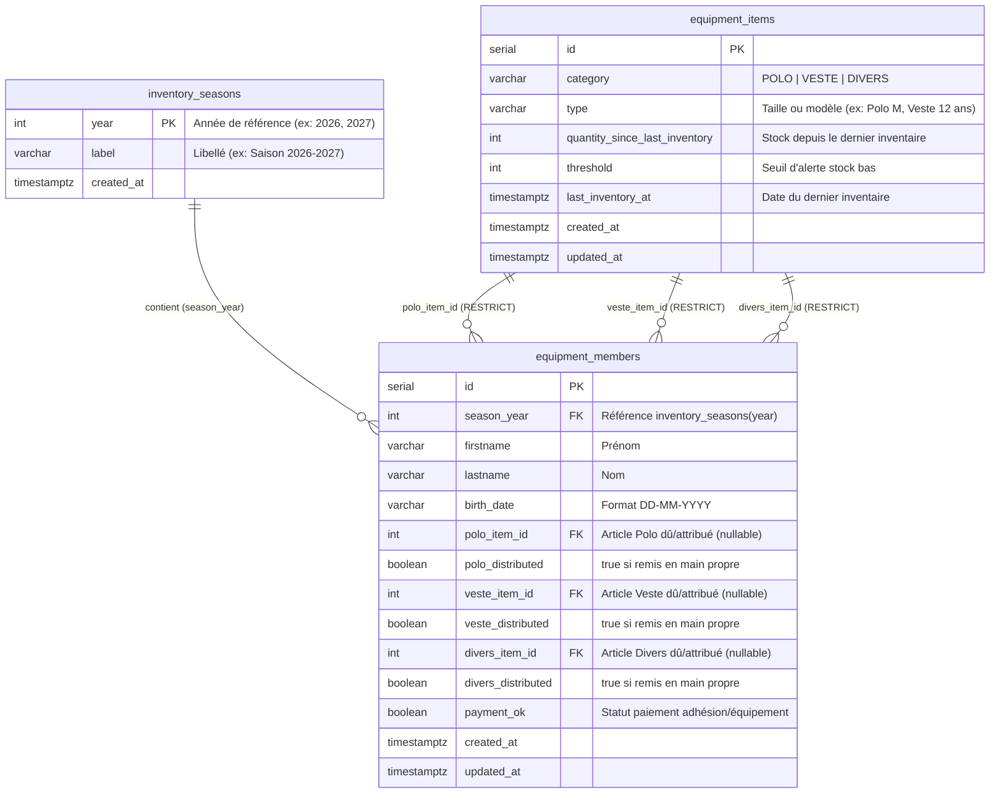

# Schéma de Base de Données — Module Inventaire & Équipements

> **Projet :** RecupFFE — Marseille-Échecs  
> **Branche :** `feat/inventory-equipment-module`  
> **Modèle :** PostgreSQL normalisé (3 tables) — Suivi des équipements distribués aux adhérents par saison (Option 2 : Dû vs Distribué).

---

## 1. Diagramme Entité-Relation (ER)



---

## 2. Définition SQL (PostgreSQL DDL)

```sql
-- 1. Saisons / Années d'inventaire (alimente le sélecteur ANNÉE et le bouton +)
CREATE TABLE IF NOT EXISTS inventory_seasons (
  year INTEGER PRIMARY KEY,
  label VARCHAR(100) NOT NULL,
  created_at TIMESTAMPTZ NOT NULL DEFAULT NOW()
);

-- 2. Catalogue des équipements (représente les 3 catégories POLO, VESTE, DIVERS)
CREATE TABLE IF NOT EXISTS equipment_items (
  id SERIAL PRIMARY KEY,
  category VARCHAR(20) NOT NULL CHECK (category IN ('POLO', 'VESTE', 'DIVERS')),
  type VARCHAR(150) NOT NULL,
  quantity_since_last_inventory INTEGER NOT NULL DEFAULT 0,
  threshold INTEGER NOT NULL DEFAULT 5,
  last_inventory_at TIMESTAMPTZ NOT NULL DEFAULT NOW(),
  created_at TIMESTAMPTZ NOT NULL DEFAULT NOW(),
  updated_at TIMESTAMPTZ NOT NULL DEFAULT NOW(),
  UNIQUE (category, type)
);

CREATE INDEX IF NOT EXISTS idx_equipment_items_category ON equipment_items(category);

-- 3. Membres & distributions par année (remplace les tables dynamiques MEMBERS_YYYY)
CREATE TABLE IF NOT EXISTS equipment_members (
  id SERIAL PRIMARY KEY,
  season_year INTEGER NOT NULL REFERENCES inventory_seasons(year) ON DELETE CASCADE,
  firstname VARCHAR(100) NOT NULL,
  lastname VARCHAR(100) NOT NULL,
  birth_date VARCHAR(20) NOT NULL DEFAULT '',
  polo_item_id INTEGER REFERENCES equipment_items(id) ON DELETE RESTRICT,
  polo_distributed BOOLEAN NOT NULL DEFAULT FALSE,
  veste_item_id INTEGER REFERENCES equipment_items(id) ON DELETE RESTRICT,
  veste_distributed BOOLEAN NOT NULL DEFAULT FALSE,
  divers_item_id INTEGER REFERENCES equipment_items(id) ON DELETE RESTRICT,
  divers_distributed BOOLEAN NOT NULL DEFAULT FALSE,
  payment_ok BOOLEAN NOT NULL DEFAULT FALSE,
  created_at TIMESTAMPTZ NOT NULL DEFAULT NOW(),
  updated_at TIMESTAMPTZ NOT NULL DEFAULT NOW()
);

CREATE INDEX IF NOT EXISTS idx_equipment_members_season ON equipment_members(season_year);
CREATE INDEX IF NOT EXISTS idx_equipment_members_polo ON equipment_members(polo_item_id);
CREATE INDEX IF NOT EXISTS idx_equipment_members_veste ON equipment_members(veste_item_id);
CREATE INDEX IF NOT EXISTS idx_equipment_members_divers ON equipment_members(divers_item_id);
```

---

## 3. Règles Métier & Champs Calculés

1. **Dû vs Distribué (Option 2)** :
   - Un joueur peut avoir un équipement **dû** (importé en début de saison via Excel avec `*_distributed = FALSE`).
   - Lorsque le responsable remet l'équipement en main propre et coche **Distribué**, le booléen passe à `TRUE`.
   - Si aucun article n'est sélectionné (`*_item_id IS NULL`), `*_distributed` est forcé à `FALSE`.

2. **Calcul temps réel du stock (`nb_distributed` et `stock_remaining`)** :
   - `nb_distributed` : nombre de lignes dans `equipment_members` où l'article est référencé **ET** marqué `*_distributed = TRUE`.
   - `stock_remaining = quantity_since_last_inventory - nb_distributed`.
   - `is_low_stock = stock_remaining <= threshold`.
   - Ce calcul agrégé garantit l'absence totale de dérive entre la liste des membres et le stock affiché.

3. **Protection contre la suppression (`DELETE ITEM IF NEVER USED`)** :
   - `usage_count` compte toutes les références d'un article dans `equipment_members` (toutes années confondues, qu'il soit dû ou déjà distribué).
   - `can_delete = (usage_count === 0)`.
   - La contrainte SQL `ON DELETE RESTRICT` + la vérification applicative renvoient une erreur explicite (`ITEM_IN_USE` / HTTP `409 Conflict`) si l'on tente de supprimer un article déjà référencé.

4. **Déduplication lors de l'import Excel** :
   - Sur une saison donnée (`season_year`), l'import en lot identifie les joueurs existants sur la clé normalisée `(season_year, LOWER(firstname), LOWER(lastname), birth_date)` pour mettre à jour sans créer de doublons.
