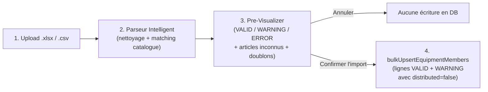

# Parseur Excel & Prévisualiseur — Module Inventaire & Équipements

> **Module :** `src/lib/parser/inventory_excel.ts`  
> **Tests :** `src/lib/parser/__tests__/inventory_excel.test.ts` (18 tests unitaires)  
> **Objectif :** Importer sans friction une liste Excel (`.xlsx` / `.csv`) de joueurs du club en début de saison avec leurs équipements dus, tout en imposant une **prévisualisation transparente (Pre-Visualizer)** avant toute écriture en base de données.

---

## 1. Flux de l'Importateur & Prévisualiseur

### Étapes détaillées
1. **Lecture & nettoyage** : `parseInventoryExcelBuffer()` lit la première feuille du classeur via `xlsx` et nettoie chaque cellule (espaces insécables `\u00A0`, retours à la ligne, tabulations, apostrophes courbes `’`).
2. **Détection souple des en-têtes** : reconnaît automatiquement les variantes de titres (`Prénom` / `Firstname`, `Nom` / `Nom de famille` / `Lastname`, `Nom & Prénom`, `Date de naissance` / `Né(e) le`, `Paiement` / `Règlement`, `Polo` / `Taille Polo`, `Veste`, `Divers`, ainsi que les colonnes optionnelles `* distribué`). Les colonnes étrangères sont ignorées.
3. **Construction du modèle de prévisualisation (`InventoryImportPreview`)** :
   - **`rows`** : chaque ligne conserve son `rowNumber` Excel exact, ses données normalisées, son statut (`VALID` / `WARNING` / `ERROR`), ses `warnings[]`, ses `errors[]` et `isDuplicateInFile`.
   - **`unknownItems`** : liste consolidée des articles mentionnés dans le fichier mais absents du catalogue (groupés par catégorie `POLO`, `VESTE`, `DIVERS`).
   - **`detectedColumns`** : correspondance exacte des colonnes reconnues.
   - **`summary`** : `totalRows`, `validCount`, `warningCount`, `errorCount`, `importableCount`, `ignoredEmptyRows`, `duplicateInFileCount`.
4. **Confirmation (`commit`)** : seules les lignes `VALID` et `WARNING` sont importées ; les lignes en `ERROR` (prénom ou nom manquant) sont automatiquement écartées.

---

## 2. Règles de Normalisation & Edge Cases Gérés

| Domaine | Règle appliquée |
| :--- | :--- |
| **Identité** | `lastname` normalisé en MAJUSCULES ; découpage intelligent des colonnes combinées (`DE LA ROCHE Jean-Luc`, `ADJEROUD-SAADE Aksel`) ; lignes totalement vides ignorées ; prénom ou nom manquant → statut `ERROR`. |
| **Date de naissance** | Convertie au format canonique `DD-MM-YYYY` depuis `DD/MM/YYYY`, `DD-MM-YYYY`, `DD.MM.YYYY`, `YYYY-MM-DD`, objet `Date` JS ou numéro de série numérique Excel (ex. `41774` → `15-05-2014`). Validation calendaire stricte (`31/02/2015` → `WARNING`). |
| **Paiement & Distribution** | Vrai : `Oui`, `OK`, `Payé`, `Réglé`, `Validé`, `Remis`, `Distribué`, `True`, `1`, `X`. Faux : `Non`, `Impayé`, `En attente`, `False`, `0`, vide. Valeur ambiguë → `false` + `WARNING`. Par défaut `*_distributed = false`. Si marqué distribué sans article valide → forcé à `false` + `WARNING`. |
| **Catalogue Équipements** | Matching O(1) insensible à la casse, aux accents, aux tirets et espaces multiples. Valeurs `"Aucun"`, `"Non"`, `"-"`, `"N/A"`, `"RAS"`, `"0"` traitées comme `null` sans faux avertissement. Article absent du catalogue ou dans la mauvaise catégorie → `WARNING` + ajouté à `unknownItems`. |
| **Doublons** | Détection intra-fichier sur `(firstname, lastname, birthDate)` normalisés → `isDuplicateInFile = true` + `WARNING` (fusionné automatiquement par `bulkUpsertEquipmentMembers`). |

---

## 3. Couverture des 18 Tests Unitaires (`inventory_excel.test.ts`)

1. **Fichier standard** (colonnes séparées, `VALID`, `distributed = false` par défaut).
2. **Variations d'en-têtes** (français/anglais, accents, casse).
3. **Colonne combinée `Nom & Prénom`** (particules nobles, noms composés).
4. **Caractères parasites Excel** (`\u00A0`, `\r\n`, `\t`, apostrophes courbes `’`).
5. **Lignes vides ignorées & lignes incomplètes en `ERROR`**.
6. **Formats de dates texte** (`DD/MM/YYYY`, `DD-MM-YYYY`, `DD.MM.YYYY`, `YYYY-MM-DD`, 1 chiffre).
7. **Numéro de série numérique Excel (`41774`) & objet `Date` JS**.
8. **Date de naissance vide** acceptée sans avertissement.
9. **Date de naissance invalide** (`32/13/2014`, `31/02/2015`, `"inconnue"`) → `WARNING`.
10. **Variantes booléennes de paiement** (vraies et fausses).
11. **Valeur de paiement ambiguë** (`"Chèque en cours"`) → `false` + `WARNING`.
12. **Colonnes optionnelles `* distribué`** & protection contre l'incohérence (distribué sans article).
13. **Matching catalogue souple** (casse, accents, espaces multiples).
14. **Valeurs « aucun équipement »** (`Aucun`, `Non`, `-`, `N/A`, `RAS`, `0`) sans faux warning.
15. **Article inconnu & mauvaise catégorie** → `WARNING` + `unknownItems`.
16. **Détection de doublons internes** au fichier (insensible à la casse/accents).
17. **Fichier vide & colonnes parasites** ignorées proprement.
18. **Lecture bout en bout d'un vrai buffer binaire `.xlsx`** généré par SheetJS.
